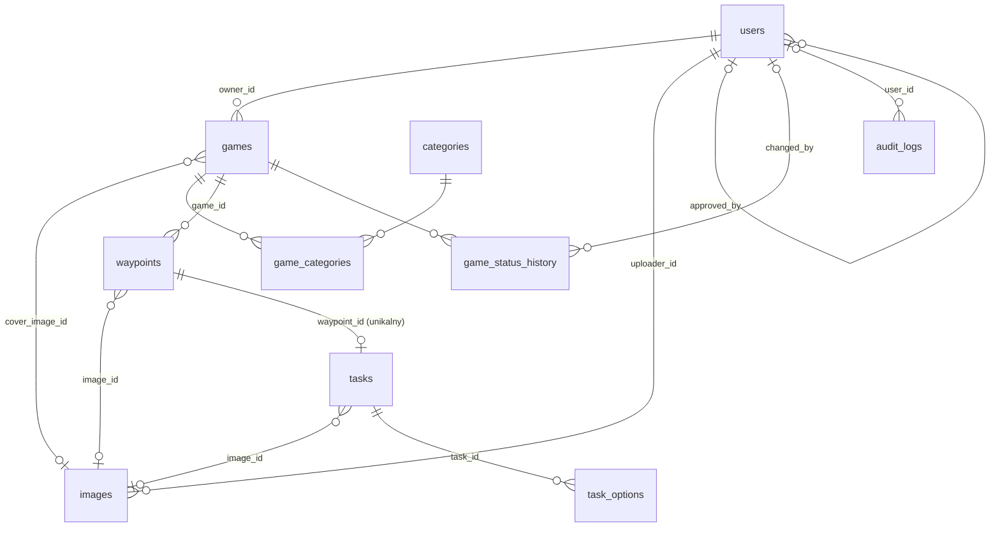

# PGM – Płockie Gry Miejskie · ETAP 1: architektura i baza danych

## 1. Plan architektury

System to jedna aplikacja PHP 8.2 + MySQL z trzema odrębnymi strefami:

| Strefa | Kto korzysta | Zakres w tej wersji |
|---|---|---|
| **Strona publiczna** (`/`) | mieszkańcy, turyści | informacje o projekcie, link „Zaloguj się” dla twórców |
| **Panel twórcy** (`/panel/...`) | pracownicy UM Płocka i upoważnione organizacje | konto, lista gier, edytor z mapą, podgląd, publikacja |
| **REST API** (`/api/v1/...`) | przyszła aplikacja Android, edytor w panelu | JSON; publiczne endpointy zwracają tylko gry opublikowane |

Zasady:

- **Jeden punkt wejścia** – `public/index.php` (front controller) + `routes/web.php`. Apache (`.htaccess`) kieruje tam wszystkie żądania, więc w katalogu `public/` nie ma wielu osobnych plików PHP do zabezpieczania. To odejście od przykładowej struktury z promptu (osobne `login.php`, `games.php` itd.) – upraszcza ochronę stron i obsługę API.
- **Prosty MVC**: kontroler przyjmuje żądanie i sprawdza uprawnienia → model wykonuje zapytania PDO (prepared statements) → widok PHP z escapowaniem `e()`.
- **Edytor gry** pracuje na API panelu (`/api/v1/admin/...`). Cały zapis gry z punktami, zadaniami i opcjami odbywa się w **jednej transakcji**; kolumna `games.lock_version` wykrywa konflikt, gdy ta sama gra jest edytowana w dwóch kartach.
- **Pliki** trafiają do `storage/uploads/` – poza katalogiem publicznym – i są wydawane przez kontroler, który sprawdza prawa dostępu.
- **Panel nie realizuje rozgrywki.** Ustawienia takie jak promień odblokowania zadania czy punktacja są tylko zapisywane – zinterpretuje je przyszła aplikacja mobilna.

## 2. Dlaczego Leaflet + OpenStreetMap

- Nie wymaga klucza API ani karty płatniczej – na hackathonie działa od razu.
- Biblioteka jest lekka i ma wszystko, czego potrzebuje edytor: przeciągane markery z numerami (`L.divIcon`), linie (`L.polyline`) i rysowanie obszaru (plugin Leaflet.draw albo Leaflet-Geoman: wielokąt i okrąg).
- Geometrię wymienia się w GeoJSON, czyli w formacie, który zapisujemy w bazie i który łatwo odczyta aplikacja Android (osmdroid, MapLibre, Google Maps SDK).
- Wyszukiwanie adresów: Nominatim (geokoder OSM), z ograniczeniem do okolic Płocka, opóźnieniem między zapytaniami i wymaganą atrybucją.

Ograniczenia, o których trzeba pamiętać:

- Publiczne kafelki `tile.openstreetmap.org` i Nominatim mają zasady użytkowania: nie służą do dużego ruchu, a Nominatim pozwala na najwyżej 1 zapytanie na sekundę. Na demo wystarczą. W produkcji adres serwera kafelków i geokodera ustawi się w konfiguracji (`MAP_TILE_URL`, `GEOCODER_URL`), np. na komercyjnego dostawcę lub serwer miejski.
- **Linia między punktami to połączenie schematyczne**, a nie trasa piesza. Długość wyświetlimy jako „przybliżona długość w linii prostej” (wzór haversine). Prawdziwą trasę pieszą można dodać później przez usługę trasowania (np. OSRM lub openrouteservice).

## 3. Struktura katalogów

```
pgm/
├── app/
│   ├── Controllers/   AuthController, AccountController, DashboardController,
│   │                  GameController, EditorController, MediaController,
│   │                  FaqController, Api/PublicGamesApi, Api/AdminGamesApi
│   ├── Models/        User, Game, Category, Waypoint, Task, TaskOption, Image
│   ├── Services/      UploadService, GameValidationService, GameSaveService,
│   │                  GameSerializer, RateLimiter, AuditLog
│   ├── Middleware/    AuthMiddleware, CsrfMiddleware
│   ├── Core/          Router, Request, Response, View, Session, Database
│   └── Views/         layouts/ public/ auth/ dashboard/ games/ editor/ account/ faq/
├── bin/               create-admin.php  (bezpieczne utworzenie pierwszego admina, CLI)
├── config/            app.php, database.php   (czytają zmienne z .env)
├── database/          schema.sql, seed.sql
├── docs/              dokumentacja etapów, API dla Androida
├── public/            ← jedyny katalog widoczny z przeglądarki
│   ├── index.php      front controller
│   ├── .htaccess      przekierowanie żądań do index.php
│   └── assets/        css/ js/ images/   (+ biblioteki Leaflet)
├── routes/            web.php (strony + API)
├── storage/
│   ├── uploads/       pliki użytkowników (.htaccess: Deny from all)
│   └── logs/
├── tests/             testy operacji backendu i API
├── .env.example
└── README.md
```

W XAMPP najlepiej ustawić wirtualny host z katalogiem głównym `pgm/public`. Wariant z adresem `http://localhost/pgm/public/` też zadziała, bo bazowy URL ustawia się w `.env`.

## 4. Model danych



| Relacja | Typ | Przy usunięciu rodzica | Dlaczego |
|---|---|---|---|
| users → games | 1:N | **RESTRICT** | nie da się skasować konta, które ma gry – najpierw trzeba je przekazać lub usunąć |
| games ↔ categories | N:M przez `game_categories` | gra: CASCADE, kategoria: RESTRICT | używanej kategorii nie można usunąć, można ją wyłączyć (`is_active`) |
| games → waypoints | 1:N | CASCADE | punkty nie istnieją bez gry |
| waypoints → tasks | 1:0..1 | CASCADE | jedno opcjonalne zadanie na punkt (`UNIQUE waypoint_id`) |
| tasks → task_options | 1:N | CASCADE | opcje istnieją tylko z zadaniem |
| images → games / waypoints / tasks | N:1 | SET NULL | usunięcie zdjęcia nie kasuje gry ani punktu |
| users → images, historia, audyt | 1:N | SET NULL | historia zostaje po usunięciu konta |

**Najważniejsze decyzje:**

- `latitude`/`longitude` jako `DECIMAL(10,7)` – dokładność ok. 1 cm, bez błędów zaokrągleń typu FLOAT. CHECK pilnuje zakresów ±90/±180.
- `waypoints.position` jest unikalna w obrębie gry. Zmiana kolejności to dwa `UPDATE` w transakcji (najpierw +10000, potem docelowe numery), dzięki czemu identyfikatory punktów i powiązane zadania się nie zmieniają.
- `games.area_geojson` (typ JSON) to GeoJSON `Feature`. GeoJSON nie ma okręgu, więc okrąg zapisujemy jako `Point` + `properties.radius_m`.
- Zadanie ma osobne kolumny dla każdego rodzaju danych (`expected_answer`, `evaluation_instructions`, `media_requirement`, `media_max_seconds`), a odpowiedzi zamknięte trafiają do `task_options`. Nic nie jest upchnięte w jednym polu tekstowym.
- `unlock_mode` / `unlock_radius_m` – ustawienia dostępności zadania dla przyszłej aplikacji. Panel je tylko zapisuje.
- `games.is_sample` oraz przedrostek `[PRZYKŁAD]` w tytule wyraźnie oznaczają dane demonstracyjne.
- Konto: `role` (`admin`/`creator`) i `account_status` (`pending`/`active`/`suspended`). Samodzielna rejestracja, jeśli zostanie włączona, tworzy konto `pending` do zatwierdzenia przez administratora.

**Reguły, których SQL nie wyrazi prostym CHECK** – sprawdza je `GameValidationService` (ETAP 5–6):

- pytanie jednokrotnego wyboru: co najmniej 2 opcje i dokładnie 1 poprawna; wielokrotnego: co najmniej 2 opcje i co najmniej 1 poprawna;
- publikacja wymaga tytułu, opisu i co najmniej jednego punktu; numeracja punktów 1..N bez luk;
- `custom_category` jest wymagana, gdy wybrano kategorię „Inne”.

**Indeksy:**

| Indeks | Do czego służy |
|---|---|
| `games (owner_id, status, updated_at)` | lista „Twoje gry”, filtr statusu, sortowanie po dacie, liczniki na dashboardzie |
| `games (status, published_at)` | publiczne API: opublikowane gry, najnowsze pierwsze |
| `FULLTEXT games (title, short_description)` | wyszukiwarka w panelu (`MATCH ... AGAINST ('Wisł*' IN BOOLEAN MODE)`) |
| `game_categories (category_id, game_id)` | filtrowanie gier po kategorii |
| `waypoints UNIQUE (game_id, position)` | kolejność punktów + szybkie pobranie trasy |
| `tasks UNIQUE (waypoint_id)` | jedno zadanie na punkt + szybkie złączenie |
| `login_attempts (email_hash, …)`, `(ip_address, …)` | limit prób logowania na konto i na adres IP |
| indeksy na każdym kluczu obcym | szybkie złączenia i kaskady |

**Aplikacja mobilna – tabele utworzone w etapie 7 (opis API: `docs/API-android.md`):**
`players` (konta graczy, osobne od `users`), `game_sessions` (przejście gry: start, koniec, wynik), `session_waypoints` (dotarcie do punktu z pozycją GPS), `task_submissions` (odpowiedź na zadanie + punkty + stan oceny), `submission_media` (zdjęcia i filmy graczy). Ranking jest liczony zapytaniem z `game_sessions`. Tabele odwołują się do istniejących `games`, `waypoints` i `tasks` – wcześniejszy schemat nie wymagał przebudowy.

## 5. Import bazy (XAMPP, Windows)

1. Uruchom **XAMPP Control Panel** i włącz **Apache** oraz **MySQL**.
2. Otwórz `http://localhost/phpmyadmin`.
3. Wybierz zakładkę **Import** (bez zaznaczania bazy po lewej) → plik `database/schema.sql` → **Importuj**. Skrypt sam utworzy bazę `pgm` z kodowaniem `utf8mb4_polish_ci`.
4. Ponownie **Import** → `database/seed.sql` → **Importuj**.
5. Kontrola: w bazie `pgm` powinno być 21 tabel, 11 kategorii, 4 gry z tytułami `[PRZYKŁAD] …`, 21 rodzajów miejsc, ok. 1300 miejsc i 504 ulice.

Z wiersza poleceń (`C:\xampp\mysql\bin`):

```
mysql -u root --default-character-set=utf8mb4 < C:\sciezka\pgm\database\schema.sql
mysql -u root --default-character-set=utf8mb4 < C:\sciezka\pgm\database\seed.sql
```

Parametr `--default-character-set=utf8mb4` jest ważny – bez niego konsola Windows może wyświetlać polskie znaki jako krzaczki.

⚠️ `schema.sql` usuwa i tworzy tabele od nowa. Nie uruchamiaj go na bazie z prawdziwymi danymi.

Dla aplikacji warto utworzyć osobnego użytkownika bazy zamiast `root` (phpMyAdmin → Konta użytkowników): uprawnienia `SELECT, INSERT, UPDATE, DELETE` tylko do bazy `pgm`. Dane dostępowe trafią do pliku `.env` w ETAPIE 2.

## 6. Założenia przyjęte w tym etapie

- Jedno opcjonalne zadanie na punkt trasy – tak opisuje to prompt („opcjonalne zadanie”). Gdyby punkt miał mieć kilka zadań, wystarczy usunąć `UNIQUE (waypoint_id)` i dodać kolumnę `position`.
- Dwie role: `admin` (zarządza kontami i wszystkimi grami) i `creator` (tylko własne gry). Współdzielenie gry między kilku twórców można dodać później tabelą `game_editors`.
- Organizacja jest polem tekstowym w `users` (zgodnie z promptem). Gdy organizacji będzie wiele, łatwo wydzielić osobną tabelę.
- Resetowania hasła e-mailem nie wdrażamy na hackathon, więc nie ma tabeli tokenów. Hasła resetuje administrator.
- Dozwolone obrazy to JPEG, PNG i WebP do 10 MB. Limit pilnuje też baza (`CHECK`, `ENUM`).
